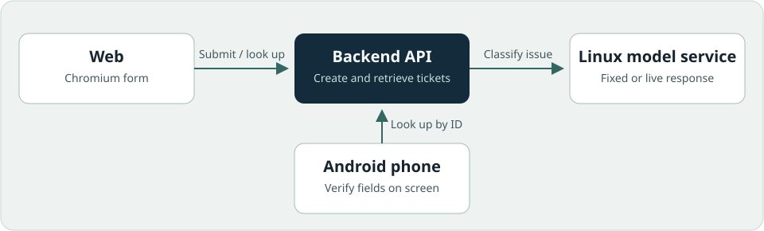
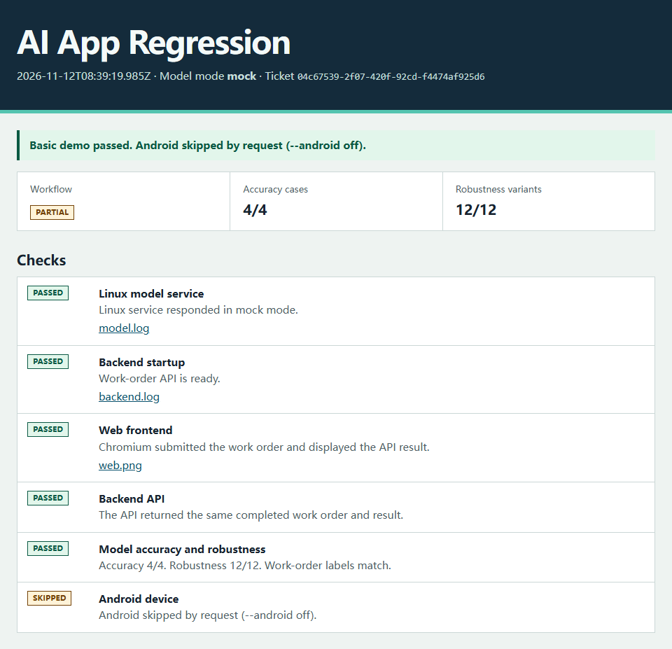

# AI App Regression

[简体中文](README.zh-CN.md)

Run one maintenance ticket through a real browser, a backend API, a Linux model
service, and an Android phone. One command produces an HTML report with the
ticket ID, labelled examples, and evidence from each check.

[Open the four-layer example report](https://leejunhao791.github.io/ai-app-regression/) · [Quick start](#quick-start) · [Step-by-step guide](docs/getting-started.md)



The demo submits `三号泵启动后异响` (Pump 3 makes an abnormal noise). Web, an
independent API lookup, and the Android app verify the same completed work order
by ID. The expected result is `pump-3 / noise`.

## Quick start

Use Node.js 22+ and Python 3.10+. On Windows and macOS, start Docker with Linux
containers to run the model service. On Linux, the command starts the service
directly. From the repository root, run the demo with fixed model responses.

```sh
npm ci
npx playwright install chromium --only-shell
node workflow/run.mjs --android off
```

On Linux, use `npx playwright install chromium --only-shell --with-deps` for
the browser installation step to install system dependencies too.

The terminal and `artifacts/run-…/report.html` show **Basic demo passed. Android
skipped by request (--android off).** The workflow badge shows **partial**
because Android was excluded. Use the [step-by-step guide](docs/getting-started.md)
to add an Android phone, a real model, or both.

## Example report



## Use your own samples

Try the editable [JSON template](fixtures/custom-tickets.example.json).

```sh
node workflow/run.mjs --fixtures fixtures/custom-tickets.example.json --android off
```

Copy the template and edit the inputs and expected results. The report shows
the expected and observed labels, duration, and verdict for each row.
See [sample format and validation](docs/getting-started.md#use-your-own-samples).

Evaluate the same samples without starting the demo app.

```sh
node workflow/run.mjs --model-only --fixtures fixtures/custom-tickets.example.json
```

See [model-only evaluation](docs/getting-started.md#model-only-evaluation) for live models and CI.

## What the report verifies

- **Web and API.** Playwright submits the form in Chromium. The runner
  independently fetches the completed ticket and checks its ID, status, and data.
- **Android.** Instrumentation enters that ticket ID in the app and checks the
  displayed fields on a physical device.
- **Model.** Four original cases check exact field accuracy. Twelve variants
  exercise paraphrases, field order, missing information, and a deliberate
  typo. A robustness case passes when the original and variant both match
  the label. Each row records elapsed milliseconds and, on failure, a
  reason such as a provider timeout, invalid JSON, or a label mismatch.
  Mock scores exercise the test harness. Live scores apply to this small
  labelled sample.

To see a failure report, inject a wrong device ID:

```sh
node workflow/run.mjs --fault wrong-device --android off
```

The Web and API steps can agree on the wrong label. The model check still fails
and shows the expected and observed values. The guide also includes a
[real model timeout example](docs/getting-started.md#model-timeout-example).

## Development checks

```sh
npm test
python -B -m unittest discover -s tests -p 'test_*.py' -v
```

[GitHub Actions](https://github.com/LeeJUNhao791/ai-app-regression/actions) runs the positive and negative workflow in
Chromium with the Linux model service. It also compiles the Android app and
instrumentation APKs. Use a connected phone for the device run.

The v0.1 device run passed on a Pixel 4 XL with Android 11 (API 30), using
Chromium, the Python backend, and the mock model service in a Linux container.
All 4 original cases and 12 robustness variants passed in mock mode.

The v0.1.1 live run used `qwen3.6-flash` in a Linux container and a Pixel 4 XL
running Android 11 (API 30, `arm64-v8a`). Chromium created work order
`e96fb437-30da-430f-a239-deb49891ddb6`. The independent API lookup and Android
instrumentation matched the same ID and fields (`pump-3`, `noise`, `completed`).

The live suite passed 4/4 original cases and 11/12 robustness variants.
`pump-noise.2` timed out after 30.03 seconds during the full run. An isolated
retest with the same model configuration returned the expected `pump-3 / noise`
in 2.88 seconds.

## License

[MIT](LICENSE)
