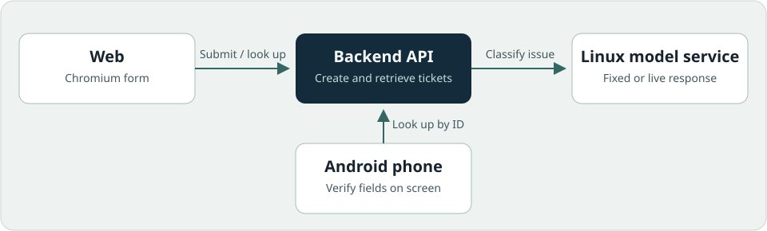
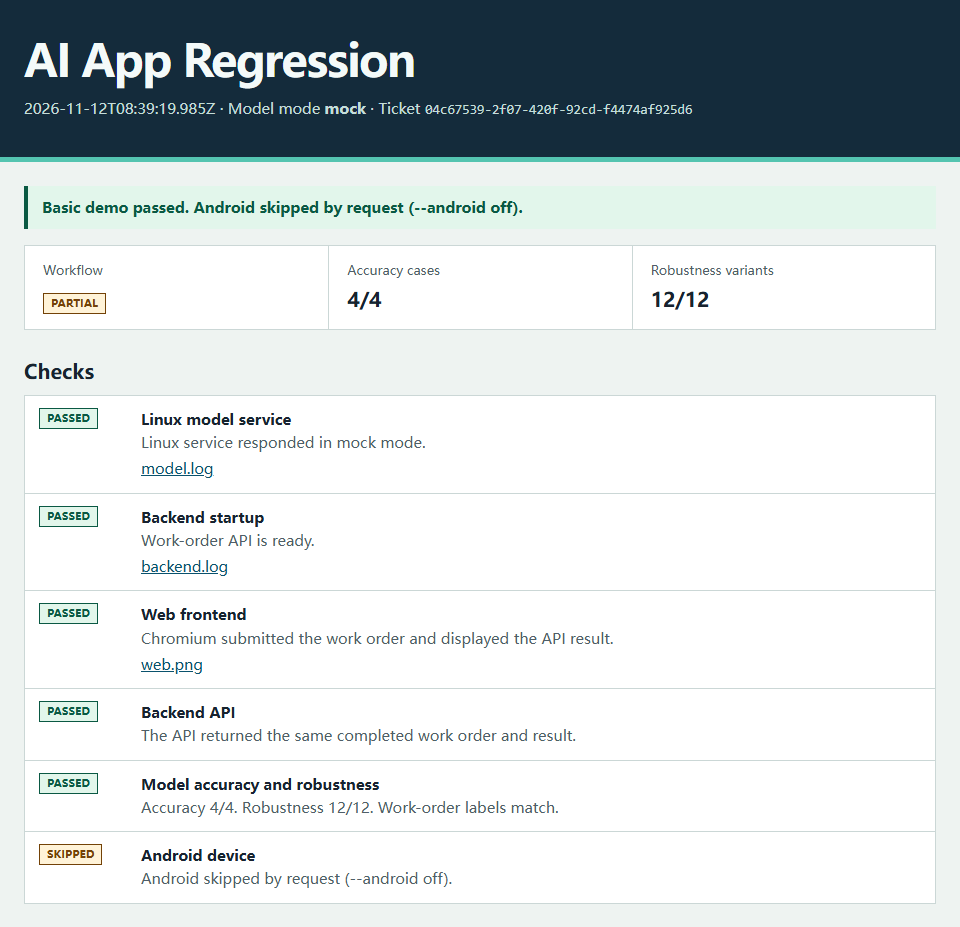

# AI App Regression

[English](README.md)

用同一张维修工单验证真实浏览器、后端 API、Linux 模型服务和 Android 真机。一条命令生成 HTML 报告，记录工单 ID、标注样例和各项检查的证据。

[快速开始](#快速开始) · [上手教程](docs/getting-started.zh-CN.md)



演示提交「三号泵启动后异响」。Web、独立 API 查询和 Android 应用按 ID 核对同一张已完成的工单，预期识别结果为 `pump-3 / noise`。

## 快速开始

使用 Node.js 22+ 和 Python 3.10+。Windows 和 macOS 上需要启动 Docker 的 Linux 容器环境来运行模型服务。Linux 上会直接启动模型服务。在项目根目录运行以下命令，使用固定模型响应完成演示。

```sh
npm ci
npx playwright install chromium --only-shell
node workflow/run.mjs --android off
```

Linux 上请将浏览器安装步骤替换为 `npx playwright install chromium --only-shell --with-deps`，同时安装系统依赖。

终端和 `artifacts/run-…/report.html` 都会显示 **Basic demo passed. Android skipped by request (--android off).**，即基础演示通过、Android 按选项跳过。由于本次未包含 Android，工作流标记为 **partial**。[上手教程](docs/getting-started.zh-CN.md)提供只接真机、只接真实模型、两者都接三种跑法。

## 报告示例



## 报告验证了什么

- **Web 和 API。** Playwright 在 Chromium 中提交表单。测试脚本独立查询已完成的工单，并核对 ID、状态和数据。
- **Android。** 仪器化测试在真机应用中输入工单 ID，核对屏幕上显示的字段。
- **模型。** 4 条原始样例检查字段是否与标注完全一致。12 条变体覆盖改写、字段顺序调整、信息缺失和故意引入的拼写错误。原始样例和对应变体都匹配标注时，该变体才算通过。报告逐条记录毫秒耗时，失败时列出超时、JSON 无效或字段与标注不符等原因。固定响应的分数用于验证测试流程，真实模型的分数对应本次标注样例。

想查看失败报告，可以注入一个错误的设备 ID。

```sh
node workflow/run.mjs --fault wrong-device --android off
```

Web 和 API 可能返回相同的错误结果。模型检查会标记失败，并展示预期值和实际值。也可以查看教程里的[模型超时示例](docs/getting-started.zh-CN.md#模型超时示例)。

## 开发验证

```sh
npm test
python -B -m unittest discover -s tests -p 'test_*.py' -v
```

CI 在 Chromium 和 Linux 模型服务上运行正常场景与故障场景，并编译 Android 应用 APK 和仪器化测试 APK。真机验收需要连接手机。[GitHub Actions](https://github.com/LeeJUNhao791/ai-app-regression/actions)

v0.1 在运行 Android 11（API 30）的 Pixel 4 XL 上通过真机验收，同时使用 Chromium、Python 后端和运行在 Linux 容器中的固定响应模型服务。4 条原始样例和 12 条鲁棒性变体全部通过。

v0.1.1 的真实模型验收使用 Linux 容器中的 `qwen3.6-flash` 和运行 Android 11（API 30，`arm64-v8a`）的 Pixel 4 XL。Chromium 创建了工单 `e96fb437-30da-430f-a239-deb49891ddb6`。独立 API 查询和 Android 仪器化测试核对了相同的工单 ID 和字段（`pump-3`、`noise`、`completed`）。

这次真实模型验收通过了 4/4 条原始样例和 11/12 条鲁棒性变体。完整运行中，`pump-noise.2` 在 30.03 秒时超时。用相同配置单独复测后，模型在 2.88 秒内返回了预期结果 `pump-3 / noise`。

## 许可证

[MIT](LICENSE)
