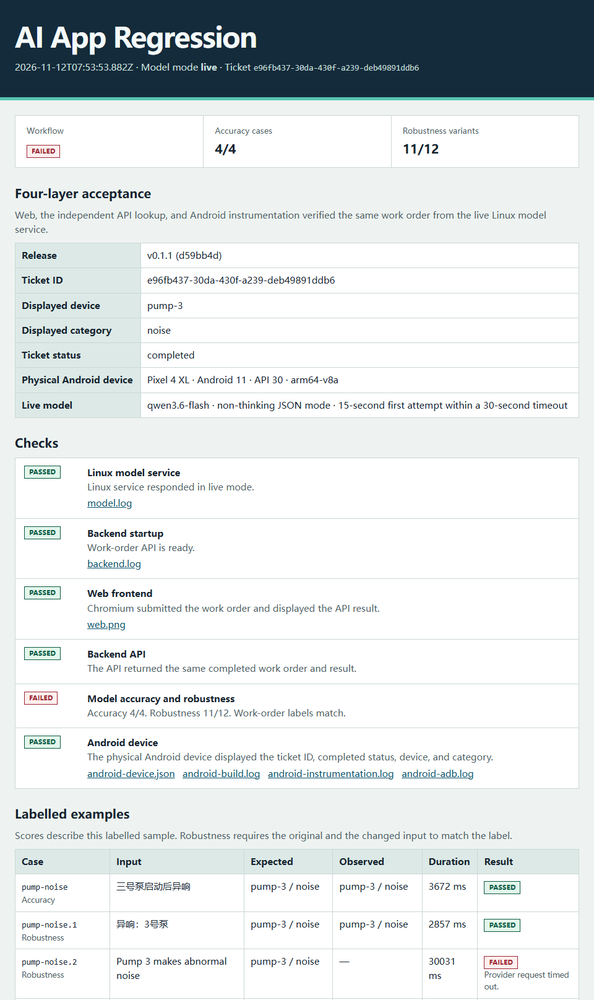

# Getting started

[简体中文](getting-started.zh-CN.md)

Run the maintenance work-order demo with fixed model responses, add a physical
Android phone, then repeat the same checks with a live model.

## 1. Run with fixed model responses

Install Git, Node.js 22+, and Python 3.10+. On Windows or macOS, start Docker
Desktop in Linux container mode. `docker info --format '{{.OSType}}'` should print
`linux`. On Linux, the runner starts the model service with Python directly.

```sh
git clone https://github.com/LeeJUNhao791/ai-app-regression.git
cd ai-app-regression
npm ci
npx playwright install chromium --only-shell
node workflow/run.mjs --android off
```

On Linux, replace the browser installation step with
`npx playwright install chromium --only-shell --with-deps` to install system
dependencies too.

Expect **Basic demo passed. Android skipped by request (--android off).** in
the terminal and at the top of the printed `report.html`. The Web frontend,
backend API, and Linux model service pass, with **4/4** accuracy cases and
**12/12** robustness variants. The **partial** badge indicates that Android was
excluded from this run. This run requires no API key.

## 2. Add a physical Android phone

1. Install JDK 17, Android SDK Platform 35, Build Tools 35.0.0, and
   Platform-Tools. Set `JAVA_HOME` to the JDK folder and `ANDROID_HOME` to the
   SDK folder. Add the SDK's `platform-tools` folder to your `PATH`.
2. Connect an Android 7.0+ phone with a USB data cable. Unlock it, enable USB
   debugging, and accept the prompt to authorize your computer. Run
   `adb devices` and confirm the phone has status `device`.
3. Keep the phone unlocked and run the same demo from the repository root.

```sh
node workflow/run.mjs --android required
```

Expect **Android device** and the overall workflow to pass. The instrumentation
looks up the Web-created ticket on the phone and checks its ID, device
(`pump-3`), category (`noise`), and status (`completed`) against the independent
API result. Open `web.png` and `android-instrumentation.log` from the report to
review the evidence.

The runner builds and installs temporary demo and test APKs and forwards a
local port over ADB. It removes the APKs and port mapping after the check.
Use a phone without the demo and test packages already installed. If several
devices are attached, add `--serial SERIAL` using the phone's serial from
`adb devices`.

## 3. Repeat with a live model

Set the environment variables in the terminal you will run the workflow from.
Replace the example URL and model ID with the provider's values. The API base
should end in `/v1` for an endpoint at `/v1/chat/completions`. Enter the API key
only if the provider requires authentication.

**PowerShell**

```powershell
$env:LLM_BASE_URL = 'https://api.example.com/v1'
$env:LLM_MODEL = 'your-model-id'
$env:LLM_API_KEY = [System.Net.NetworkCredential]::new('', (Read-Host 'API key' -AsSecureString)).Password
node workflow/run.mjs --live --android required
```

**Bash**

```bash
export LLM_BASE_URL='https://api.example.com/v1'
export LLM_MODEL='your-model-id'
read -rs -p 'API key: ' LLM_API_KEY
echo
export LLM_API_KEY
node workflow/run.mjs --live --android required
```

Use the provider's network address as seen from the Linux model service. For a
provider running on the Docker Desktop host, use `host.docker.internal` in the
URL. If you already have a Linux instance of this project's model service,
configure live mode and provider credentials on that instance and add
`--model-url URL` to the workflow command.

The model service sends synthetic work-order text to the configured provider.
It expects a JSON object with `device` and `category` in the Chat Completions
message content. A single Markdown code block around the JSON is supported.
If the model supports these options, set `LLM_ENABLE_THINKING=false` for
non-thinking mode and `LLM_JSON_MODE=true` to request JSON output.

In the new report, confirm **Model mode** is **live**, then check Web, Backend API,
and Android for the same completed work order. Review all 16 labelled rows for
expected fields, observed fields, elapsed time, and failure reasons. A passing
work-order check can appear alongside a failed model evaluation.

## Troubleshoot from the report

| What you see | What to check |
| --- | --- |
| Linux model service did not start | Check `model.log`. On Windows or macOS, verify Docker is running Linux containers. |
| Chromium could not start | Run `npx playwright install chromium --only-shell` from the repository root. On Linux, add `--with-deps` to install system dependencies. |
| ADB lists the phone as `unauthorized` | Unlock the phone and accept the USB debugging prompt, then run `adb devices` again. |
| Android build or install failed | Open `android-build.log` or `android-adb.log`. Check JDK 17, SDK Platform 35, and any installation prompt on the phone. |
| Provider rejected the request | Check the API base, model ID, key, and any optional model settings. |
| Model request timed out | Check the failed row and its duration. Each provider call has a 30-second total budget. A shorter first-attempt limit via `LLM_ATTEMPT_TIMEOUT_SECONDS` leaves time for one retry within that budget. |
| Invalid JSON or wrong labels | Compare the expected and observed fields and read the row's failure reason. Check that the selected model can return the required JSON fields. |

Each run saves `report.html`, `report.json`, and available screenshots and logs.
Use `--output path/to/new-directory` to choose a fresh destination. A failed
check produces a nonzero exit code and still writes the report.

### Model timeout example

This live v0.1.1 run matched the same completed work order in Chromium, the API,
and a Pixel 4 XL. The workflow shows **failed** because `pump-noise.2` timed out
against `qwen3.6-flash`. The failed row shows the duration and failure reason.



[Back to the project README](../README.md)
