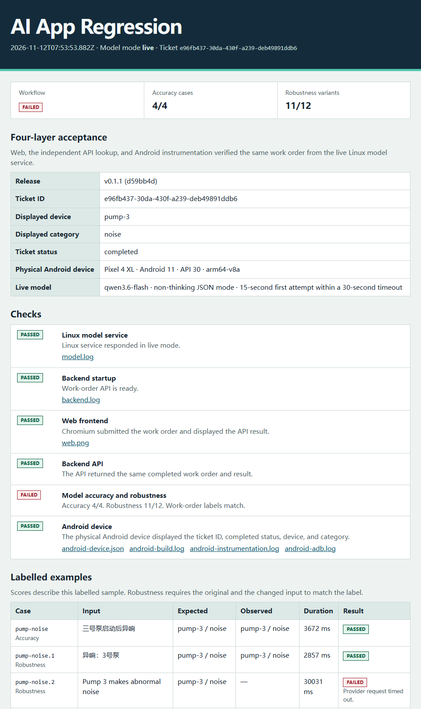

# 上手教程

[English](getting-started.md)

先用固定模型响应跑通维修工单演示，再选择只接 Android 真机、只接真实模型，或两者都接。

## 1. 用固定模型响应运行

安装 Git、Node.js 22+ 和 Python 3.10+。在 Windows 或 macOS 上，启动 Docker Desktop 并使用 Linux 容器模式。`docker info --format '{{.OSType}}'` 应输出 `linux`。在 Linux 上，测试脚本会直接用 Python 启动模型服务。

```sh
git clone https://github.com/LeeJUNhao791/ai-app-regression.git
cd ai-app-regression
npm ci
npx playwright install chromium --only-shell
node workflow/run.mjs --android off
```

Linux 上请将浏览器安装步骤替换为 `npx playwright install chromium --only-shell --with-deps`，同时安装系统依赖。

终端和输出路径中的 `report.html` 顶部应显示 **Basic demo passed. Android skipped by request (--android off).**，即基础演示通过、Android 按选项跳过。Web 前端、后端 API 和 Linux 模型服务应通过检查，准确性为 **4/4**，鲁棒性为 **12/12**。**partial** 表示本次运行未包含 Android。这一步无需 API Key。

## 使用自己的样例

先运行[可编辑的模板](../fixtures/custom-tickets.example.json)。它包含两条原始样例和一条鲁棒性变体。

```sh
node workflow/run.mjs --fixtures fixtures/custom-tickets.example.json --android off
```

复制模板为自己的 UTF-8 JSON 文件，把 `--fixtures` 指向该文件。相对路径以当前目录为准。下文三种跑法都可以加这个参数。默认文件为 `fixtures/tickets.json`。

- 文件顶层使用非空对象数组。每条样例填写唯一且非空的 `id`，以及非空的工单 `text`。
- `expected.device` 填 `pump-1` 这样的泵编号或 `null`。`expected.category` 填 `noise`、`leak`、`overheat` 或 `unknown`。
- `variants` 可以省略，也可以填非空文本组成的数组。变体沿用原始样例的预期结果。

第一条原始样例用于端到端工单验收，模型评测会跑完所有原始样例和变体。固定响应模式由内置规则给出预测。报告会逐条对比预期值和实测值，并记录耗时和判定。文件校验失败时，终端会指出文件，字段错误还会标出样例和字段。脚本会在启动服务前退出。

## 独立模型评测

使用 Node.js 22+。本机启动模型服务时，Linux 需要 Python 3.10+，Windows 和 macOS 需要 Docker Desktop 的 Linux 容器模式。该命令只运行 Linux 模型服务和标注样例评测。

```sh
node workflow/run.mjs --model-only --fixtures fixtures/custom-tickets.example.json
```

接入真实模型时，按[只接真实模型](#只接真实模型)设置环境变量，再加 `--live`。若已有本项目的 Linux 模型服务实例，可通过 `--model-url URL` 连接。HTML 和 JSON 报告逐条记录预期、实测、耗时和判定。样例全部通过时返回退出码 0，评测或服务启动失败时返回 1，可用于 CI。

## 领域配置

复制[风机配置](../fixtures/fan.profile.json)和[标注样例](../fixtures/fan-tickets.example.json)。按[只接真实模型](#只接真实模型)配置服务商，再运行以下命令。

```sh
node workflow/run.mjs --model-only --live --profile fixtures/fan.profile.json --fixtures fixtures/fan-tickets.example.json
```

- `system_prompt` 是发给模型服务商的系统提示词。预测结果仍使用 JSON 字段 `device` 和 `category`。
- `device_id_pattern` 必须匹配完整设备 ID。请使用 JavaScript 和 Python 都支持的正则语法，例如 `fan-[1-9][0-9]*`。设备 ID 和类别标签使用 ASCII 字母、数字、下划线和连字符。设备未知时可返回 `null`。
- `categories` 列出允许的类别。预测类别超出列表或设备 ID 格式不符时，该样例会判失败。

领域配置适用于独立真实模型评测和端到端流程。使用 `--model-url` 连接独立部署的服务时，请将同一份 JSON 通过 `MODEL_PROFILE_JSON` 传给该服务。内置固定响应演示使用默认泵配置。

## 选择跑法

要测试自己的工单接口，请看[外部后端](#外部后端)。

| 跑法 | 验证内容 |
| --- | --- |
| [只接 Android 真机](#只接-android-真机) | 用固定模型响应，在手机上核对同一张工单。 |
| [只接真实模型](#只接真实模型) | 通过 Web 和 API 验证真实模型，跳过 Android。 |
| [Android 真机和真实模型都接](#android-真机和真实模型都接) | 在四端核对同一张真实模型工单。 |

### 只接 Android 真机

1. 安装 JDK 17、Android SDK Platform 35、Build Tools 35.0.0 和 Platform-Tools。将 `JAVA_HOME` 指向 JDK 目录，将 `ANDROID_HOME` 指向 SDK 目录，并把 SDK 下的 `platform-tools` 目录加入 `PATH`。
2. 用 USB 数据线连接一台 Android 7.0+ 手机。解锁手机，打开 USB 调试，并在弹窗中授权当前电脑。运行 `adb devices`，确认手机状态为 `device`。
3. 保持手机解锁，在项目根目录用固定模型响应运行演示。这种跑法无需 API Key。

```sh
node workflow/run.mjs --android required
```

**Android device** 和整次运行都应通过。仪器化测试在手机上查询由 Web 创建的工单，并与独立 API 查询结果核对工单 ID、设备（`pump-3`）、类别（`noise`）和状态（`completed`）。可以在报告中打开 `web.png` 和 `android-instrumentation.log` 查看证据。

测试脚本会构建并临时安装演示和测试 APK，通过 ADB 映射本地端口，并在检查结束后移除 APK 和端口映射。请使用尚未安装这两个应用包的手机。如果连接了多台设备，请加上 `--serial SERIAL`，并使用 `adb devices` 中对应手机的序列号。

### 只接真实模型

在运行测试的终端中设置环境变量，把示例地址和模型 ID 换成服务商提供的值。如果接口路径为 `/v1/chat/completions`，基础地址应以 `/v1` 结尾。服务商要求鉴权时再输入 API Key。由脚本启动模型服务时，如果漏填 `LLM_BASE_URL` 或 `LLM_MODEL`，终端会列出缺项。

**PowerShell**

```powershell
$env:LLM_BASE_URL = 'https://api.example.com/v1'
$env:LLM_MODEL = 'your-model-id'
$env:LLM_API_KEY = [System.Net.NetworkCredential]::new('', (Read-Host 'API key' -AsSecureString)).Password
```

**Bash**

```bash
export LLM_BASE_URL='https://api.example.com/v1'
export LLM_MODEL='your-model-id'
read -rs -p 'API key: ' LLM_API_KEY
echo
export LLM_API_KEY
```

运行真实模型检查，跳过 Android。

```sh
node workflow/run.mjs --live --android off
```

使用 Linux 模型服务能访问的地址。如果服务商接口运行在 Docker Desktop 的宿主机上，请在 URL 中使用 `host.docker.internal`。如果本项目的模型服务已经运行在 Linux 上，请在该实例中设置真实模型模式和服务商凭据，再给测试命令加上 `--model-url URL`。

模型服务会将构造的工单文本发给配置好的服务商。Chat Completions 的消息内容应返回包含 `device` 和 `category` 的 JSON 对象，也支持用一层 Markdown 代码块包裹 JSON。如果模型支持相关选项，可以设置 `LLM_ENABLE_THINKING=false` 关闭思考模式，设置 `LLM_JSON_MODE=true` 请求 JSON 输出。

在报告中确认 **Model mode** 为 **live**，并核对 Web 和后端 API 是否查到同一张已完成的工单。查看 16 条标注样例的预期字段、实际字段、耗时和失败原因。工单核对通过时，模型评测仍可能有失败样例。如果本次选中的检查都通过，总状态为 **partial**，因为 Android 已按选项跳过。

### Android 真机和真实模型都接

按[只接 Android 真机](#只接-android-真机)配置手机，按[只接真实模型](#只接真实模型)设置服务商环境变量，然后运行四端验收。

```sh
node workflow/run.mjs --live --android required
```

脚本会在启动模型服务或发送模型请求前检查 ADB 授权。若授权失败，解锁手机并接受 USB 调试授权后再运行。打开报告，核对 Web、后端 API 和 Android 的工单 ID 和字段，再查看模型评测分数。

## 外部后端

使用 Node.js 22+。先在一个终端启动替代示例后端。

```sh
node examples/alternate-backend.mjs
```

在另一个终端进入仓库根目录，运行 API 验收。

```sh
node workflow/run.mjs --backend-url http://127.0.0.1:8090 --backend-map fixtures/alternate-backend.map.json --fixtures fixtures/custom-tickets.example.json
```

接入自己的测试 API 时，复制[字段映射模板](../fixtures/alternate-backend.map.json)并修改。每次运行会用第一条原始样例创建一张工单。

- `create_path` 是 POST 路径，`request_text_field` 是请求 JSON 顶层存放工单文本的字段。示例使用 `/v2/orders` 和 `description`。
- `lookup_path` 是包含一个 `{id}` 占位符的 GET 路径。脚本会用创建接口返回的 ID 做 URL 编码后查询。两个路径都拼接到基础地址后面。
- `response` 将 `id`、`text`、`status`、`device` 和 `category` 映射到 JSON 字段路径，例如 `order.reference`。创建和查询接口使用同一种响应结构。ID 可用非空字符串或安全整数，`completed_status` 填两个接口都会返回的完成状态，例如 `resolved`。

本模式验收同步 JSON 接口。POST 接受 HTTP 200 或 201，GET 要求 HTTP 200。报告会显示工单 ID，并核对创建和查询映射出的 ID、文本、状态和分类一致，分类还须符合样例预期。若 API 使用自定义设备 ID 或类别，可加 `--profile`。提示词和模型由外部 API 自己管理。本模式只运行外部 API 检查。

## 根据报告排障

| 现象 | 检查方法 |
| --- | --- |
| Linux 模型服务未启动 | 查看 `model.log`。在 Windows 或 macOS 上，确认 Docker 正在运行 Linux 容器。 |
| Chromium 未启动 | 在项目根目录运行 `npx playwright install chromium --only-shell`。Linux 上加 `--with-deps` 安装系统依赖。 |
| ADB 显示手机为 `unauthorized` | 解锁手机并接受 USB 调试授权，再运行 `adb devices`。 |
| Android 构建或安装失败 | 打开 `android-build.log` 或 `android-adb.log`。检查 JDK 17、SDK Platform 35，以及手机上是否有安装确认提示。 |
| 缺少真实模型配置 | 补齐终端列出的变量。服务商要求鉴权时才需要 `LLM_API_KEY`。 |
| 模型服务商拒绝请求 | 核对 API 基础地址、模型 ID、API Key 和可选模型配置。 |
| 模型请求超时 | 查看失败样例及耗时。每次模型调用的总预算为 30 秒。可用 `LLM_ATTEMPT_TIMEOUT_SECONDS` 缩短首次尝试的时限，为预算内的一次重试留出时间。 |
| JSON 无效或字段与标注不符 | 对照预期字段、实际字段和失败原因，确认所选模型可以返回要求的 JSON 字段。 |

每次运行会保存 `report.html`、`report.json` 及可用的截图和日志。可用 `--output path/to/new-directory` 指定新的输出目录。检查失败时，命令会以非零状态退出，同时写出报告。

### 模型超时示例

这次 v0.1.1 真实模型验收中，Chromium、API 和 Pixel 4 XL 核对了同一张已完成的工单。由于 `qwen3.6-flash` 在 `pump-noise.2` 样例上超时，工作流标记为 **failed**。失败行显示了耗时和失败原因。



[返回中文 README](../README.zh-CN.md)
